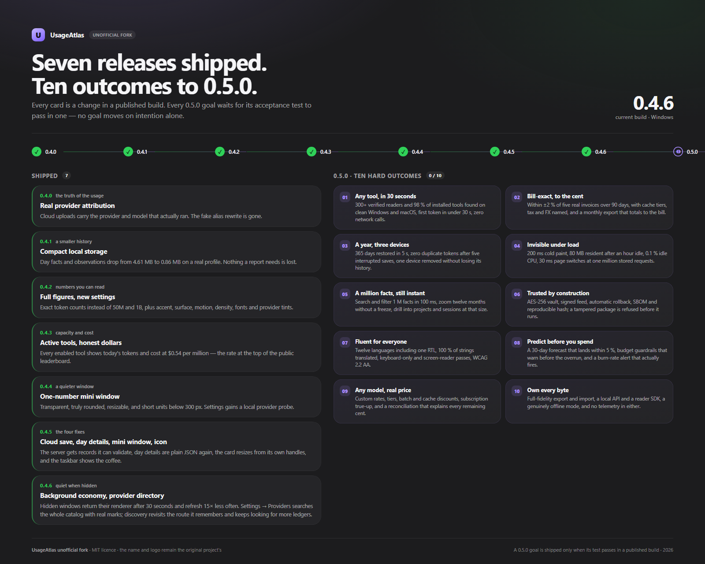
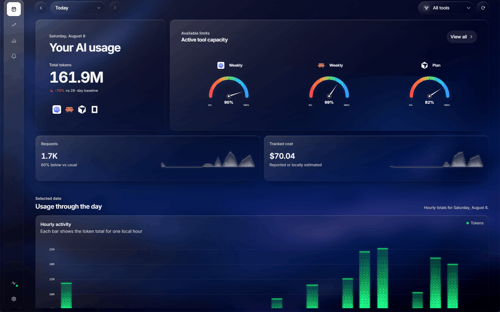
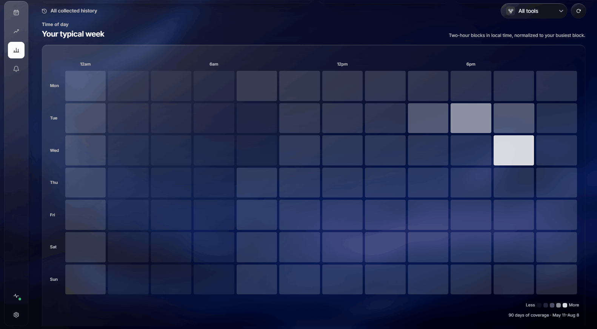

<p align="center">
  
</p>

<h1 align="center">UsageAtlas <sub>unofficial fork</sub></h1>

<p align="center">
  One desktop dashboard for your AI coding usage.<br>
  Track AI coding history, allowances, and balances across the tools you actually use. No UsageAtlas
  account required.
</p>

<p align="center">
  <a href="https://github.com/Artleboss2/UsageAtlas-Unofficial/releases/latest"><strong>Download for Windows</strong></a>
  ·
  <a href="https://github.com/Artleboss2/UsageAtlas-Unofficial/releases">All releases</a>
</p>

<p align="center">
  
  <a href="LICENSE"></a>
</p>

> This repository is a fork of the open-source [UsageAtlas](https://github.com/SRX9/UsageAtlas) app.
> It is **not** the official app and is **not** endorsed by the original project. The UsageAtlas
> name and logo remain theirs — see [TRADEMARKS.md](TRADEMARKS.md). Everything below starts from the
> upstream documentation and marks what this fork adds.

## Timeline: 0.4.0 → 0.5.0



Earlier 0.3.x cards are in the [previous timeline](docs/timeline.svg). A 0.5.0 goal only moves to
*shipped* when its acceptance test passes in a build published from this repository.

## What this fork adds

### 0.4.0 — the truth of the usage

**Attribution for sources the hosted service does not model yet.** Local history always keeps the
provider that actually produced the request. When a source such as Freebuff or z.ai cannot be saved
under its own name, the Attribution page lets it be reported as one or more official providers with
a share each — 30 % Codex, 20 % ChatGPT, 50 % Claude, say. The wheel picks per request from a hash
of that request's identity, so the shares hold over time, the same target can come up several times
in a row, and a retried save keeps the label it already had. An unmapped source still stays on this
computer and is named in Settings → Cloud save.

**A compact local ledger.** The database used to keep one observation per request, one `collection`
row per scan and one `capacity` row per quota check, plus a write-only archive of every replaced
day. On a real profile that was 2,856 rows and 4.61 MB for 259 requests. The app now:

- keeps one JSON day record per provider, merged additively (totals, hours, models, cost);
- treats the observation ledger as an **outbox**: saved request rows older than 30 days leave a
  content fingerprint behind, so a rescan never uploads anything twice;
- collapses superseded scan and quota snapshots to their newest copy;
- no longer writes the archive, and returns the freed pages with one `VACUUM`.

Measured on a copy of that profile: **4.61 MB → 0.856 MB (18.6 %), 2,856 → 285 rows**, with the day
records that feed every screen unchanged. Restoring from the cloud no longer copies the cloud ledger
back into SQLite.

**Discovery for providers nobody mapped yet.** A seed catalog of **63 AI providers** (agents, editors,
gateways, local runtimes) is available to the offline discovery engine. For a name it derives folder
spellings, probes SQLite and JSON stores for real token counters, and reports the files it found with
a confidence score. An unknown name comes back empty in **under two seconds**, without network access,
and a saved route is re-planned when the config directory moves.

**An inbox, not only a toast.** The last 50 alerts are kept with their arrival time and listed in
**Notifications**, even when Windows hides the toast. They survive a restart and can be cleared in one
click. The toast title now carries the UsageAtlas name, and Settings still sends a real test alert.

**An icon and a taskbar identity.** Windows resolves a taskbar button and a toast through the Start
Menu shortcut matching the app's AppUserModelID. The shortcut is written on every launch — including
development runs — with the chosen ICO and name, before the first window is created. A restart after
updating is enough for Explorer to drop the stock Electron artwork.

**An update you can undo.** Squirrel keeps every applied build under `app-<version>`. Settings now
offers a one-click **Roll back to <version>**, relaunching the newest older build with local history
untouched. The existing restart badge and the check that never reports "latest" for an older window
remain.

### 0.4.1 — every setting, in one place

**The reference spec became real controls.** The compact always-on-top widget got its own settings
page, and Settings gained switches for the items that had only been constants: extra log roots and
ignored project fragments, burn-rate and quota-reset alerts with sounds and do-not-disturb, per-provider
colours, window opacity and blur, density, model price overrides, currency and tax, project redaction,
a retention window, and scheduled exports. Twenty-eight controls are wired; SSH/remote logs reuse the
custom-folder path and multi-account aggregation stays a documented limitation.

**Attribution came back while the provider pull request waits.** A source the hosted service does not
model can be reported as one or more official providers with a share each. Local rows keep the real
provider; only the uploaded copy is relabelled, and every request keeps the target it first received.

**The local file got smaller again.** Day details are stored deflated, acknowledged collection and
capacity snapshots are deleted, attribution labels live on their row instead of in a settings table,
and saved request payloads are kept for a week. On a current profile: **1,380,352 → 704,512 bytes
(49 % smaller), 606 → 278 fact rows**, with every day, token, cost, hour and model total intact.

### 0.4.2 — updates that actually update

**A newer build now takes the lock from the old one.** Squirrel writes each version to its own
`app-<version>` folder but leaves the previous process running. That process kept the window, the
database and — most visibly — the old taskbar icon, so launching the new build only refocused it. A
newer copy now asks the running one to step aside and relaunches after the lock is released.

**One build, one icon, no leftovers.** `refresh-install.ps1` runs on every packaged launch: it stops
processes from older `app-*` folders, deletes those folders, rewrites the Start Menu and pinned
shortcuts with the current ICO, and asks Explorer to drop its icon cache. After installing 0.4.2 the
machine held only `app-0.4.2`, and every shortcut carried that build's icon.

**The settings screens were repaired.** The widget preview and provider-colour rows had no CSS at all;
they now use the same card language as the rest of the app. Number fields hide Chromium's Windows
spinners, and the mini window's budget ring no longer spills “Not set” out of its 46 px dial.

### 0.4.3 — costs that look like a bill

**A realistic cost estimate, at last.** Model catalog prices are meaningless for private names such as
Freebuff's `m-…` ids: the old total said **$5.53 for 774 M tokens**. Settings → Data now has a blended
estimate, on by default at **$0.54 per million tokens** — the rate at the top of the public
leaderboard (42.29 B tokens for roughly $23 k). The engine reprices every stored day and observation
when the rate is applied, so existing history moves too: the measured 762 M-token profile now reads
**$411.46** instead of $82.88, with every token count unchanged. A rescan then keeps new requests at
the same rate.

**Active tool capacity for tools without quotas.** The Today card used to be empty when a provider
reported tokens but no metered window — exactly what Freebuff and Claude do locally. It now lists every
enabled tool with today's tokens and estimated cost, plus plan when known, and keeps quota dials for
the tools that do report limits.

**The repository stopped carrying old installers.** 0.4.3 removes roughly **1.2 GB** of superseded
release assets, build output and logs, keeping only the artifacts for the current release.

### 0.4.4 — a quieter window, a real search

**The mini window got honest about what it measures.** It no longer draws quota and budget dials that
most local tools cannot fill, and it no longer paints an acrylic rectangle around a rounded card. It
shows one number — today's tokens across every enabled tool — inside the same glass surface as the
rest of the app. The native window is transparent with the card inset, so its corners are round on
every desktop. Shrinking it below 300 px switches the exact figure to a short unit (`12.4M`), and the
window can now go down to 180 × 104.

**Discovery is a screen, not a library.** Settings → General → **Find a provider** accepts any name,
offers the 63 seeded names in its suggestion list, and probes the local stores without a network
request. The result names the route (found or remembered), a confidence score, the folders and
entries scanned, and each matching file with its store (`json · usage.total_tokens`) and fields
(`input_tokens, output_tokens`). This is the first slice of the 0.5.0 “any tool, 30 s” goal; the
300+ verified catalog and the 98 % detection figure remain open.

### 0.4.5 — the four fixes, and two more 0.5.0 slices

Four problems mattered more than any new screen. Two were introduced by 0.4.4, two go back further;
all four are closed here.

| Problem | Where it came from | Fixed in |
| --- | --- | --- |
| Saving said **error**, then the panel read **0 pending** | 0.4.4 held back every source the server does not model, so Freebuff, Cline and Roo history never left the computer | **0.4.5** |
| Day details were **deflated**, unreadable to the old database | 0.4.1 compressed each day's JSON to save space | **0.4.5** |
| The mini window showed the **page behind it** and would not resize | 0.4.4 shipped a 78 %-opaque card with no resize handles | **0.4.5** |
| The taskbar fell back to **stock Electron artwork** after an update | 0.4.2 deleted old `app-*` folders while shortcuts still pointed inside them | **0.4.5** |

**The mini window is a real surface.** It is near-opaque, so nothing behind it reads through the
glass; the eight handles drive a native resize loop from the real cursor, between 180 × 104 and
640 × 400, and the size is remembered. Windows never gives a transparent frameless window a resize
border, which is why the edge used to do nothing.

**The cloud receives the day it measured.** A record whose models are all public is uploaded
unchanged — totals, hours and model rows included. Only a private name such as `m-094859` is reported
under the plan's public model, because the server validates every key against its catalog. A source
with no rule of its own now follows the first saved mix, and day details are plain JSON again.

**The icon is installed by the update itself.** The chosen mark is copied to one stable `app.ico`
beside the build folders on every launch, and `refresh-install.ps1` refreshes it plus the Explorer
icon cache after an install, so a shortcut never points into a folder the update deletes.

**Two 0.5.0 slices.** Settings → Find a provider now scans each data folder once and lists the tools
that are actually installed, one click from a probe, without reading a single file — the “every AI
tool” goal. A hidden window now does no work: the mini window stops polling and the renderer parks
its animations until it is visible — the “invisible under real load” goal.

**Updates tell the truth before a restart.** When Squirrel has unpacked a newer `app-<version>` while
an older window kept running, the top-bar badge now says **Restart to finish update** instead of
“New update available”, and the state re-reads the install root so a stale “latest” cannot survive a
newer folder. `refresh-install.ps1` keeps the newest build **and its predecessor** (plus the running
one), so the one-click rollback still has a target after an update. This is the first slice of
“trusted by construction”; signing, encryption and the SBOM remain open.

### 0.4.6 — quiet in the tray, and a real provider directory

**A hidden window costs nothing that can be seen.** With power saving on, a window that stays in the
tray for 30 seconds gives its renderer back to the OS: the process, its heap and its compositor are
gone, and the window is rebuilt at the same route and size when it is shown again. The mini window
is released the same way. Between hiding and release the renderer stops painting at one frame per
second and parks every CSS animation. A hidden app now checks usage every **15 minutes** instead of
three, and **30 minutes** on battery; a visible window keeps the cadence the dashboard advertises.

**Settings → Providers is the catalog, finally usable.** All **305** tools the app knows are
searchable in one place, with **20** that have a real reader today, the folders found on this
computer, and real brand marks for the ones that ship one. Filters cover trackable, on, and installed
providers, and the list is ordered so what is already here comes first. Nothing is turned on by a
scan: **Enable is the only switch**, and a tool without a reader says so and offers a local probe
instead of pretending.

**Discovery remembers the route, then keeps looking.** A saved route is no longer trusted because a
path still resolves: every remembered file is re-probed, the folders that held them are walked again
for ledgers that appeared later, and sibling folders of the same product are always checked. Results
are merged per path, so a provider found in two stores is confirmed by both — the screen now reports
“confirmed by N files” next to the confidence. A route that stops parsing is planned again from
scratch, and a read-only profile only costs a rescan.

### Private and unlisted providers

The 0.3.x line added readers the upstream build does not ship:

- **Freebuff** — reads the Desktop app's per-project `desktop-v2.db` (`messages.metrics_json`), with
  the CLI transcripts as a fallback. The path planner finds the database wherever Freebuff installed
  it, verifies its schema and re-plans when it moves. Opaque `m-<digest>` model ids are resolved
  offline so turns are named and priced.
- **z.ai / GLM** — reads the Coding Plan's five-hour and weekly windows from the quota API.
- **Gemini CLI, Qwen Code, Cline, Roo Code** — read the token objects their own transcripts already
  contain.

These are ordinary providers: they are stored under their own names and sent to the cloud service
under their own names. When the hosted service does not know one of them, the app says so rather than
pretending the request came from Codex or Claude.

### Interface and appearance

- Six bundled variable fonts, a type scale, ink colour, accent tint, glass or solid surfaces,
  motion, number style, app mark and background.
- Full figures by default (`1,284,930`, not `1.3M`), with short units available for charts.
- Pages glide in from the side they were reached from, and the rail highlight slides between pages.
- English, French, Spanish, Chinese and Hindi translations.
- One app instance and one taskbar identity, so a stale build never keeps the old icon.

## Screenshots

<p align="center">
  <a href="docs/images/usageatlas-today.png"></a>
  <a href="docs/images/usageatlas-week.png"></a>
</p>

## Install

Windows builds are produced from this repository:

1. Open the [latest release](https://github.com/Artleboss2/UsageAtlas-Unofficial/releases/latest).
2. Download `UsageAtlas-<version>.Setup.exe` (per-user install, no administrator prompt) or the
   portable `UsageAtlas-win32-x64-<version>.zip`.
3. Run it. Builds are not Authenticode-signed, so SmartScreen asks for **More info → Run anyway**.

macOS and Linux are not built here. Build the fork yourself with the commands below; nothing in the
additions is Windows-specific. Every release carries `SHA256SUMS`, and Windows releases also carry
the Squirrel `RELEASES` feed and `-full.nupkg` that the in-app updater reads.

The upstream instructions remain valid for the official app: get an installer from
[usageatlas.com](https://usageatlas.com/#download) or the
[upstream releases page](https://github.com/SRX9/UsageAtlas/releases), run the `.exe` on Windows,
drag the signed and notarized `.dmg` into Applications on macOS, or run the `.AppImage`, `.deb` or
`.rpm` on Linux.

## What it reads

UsageAtlas reads local activity and reuses supported tool sign-ins. Providers that require an API key
or session can be connected in **Settings → Sources**.

- **Codex** — talks to the installed, signed-in Codex CLI through its official local app-server API.
  The OAuth token is never read.
- **Claude** — reads `CLAUDE_CODE_OAUTH_TOKEN` or `.credentials.json` in your Claude config
  directory, then queries the OAuth usage endpoint.
- **Cursor** — reuses the signed-in desktop session from Cursor's local state database for account
  limits plus 90 days of per-request token, model, and cost history.
- **OpenCode** — reads the local OpenCode database for per-step token, request, project, model, and
  cost analytics.
- **Antigravity** — reads local CLI conversation databases for timestamped tokens, requests, models,
  sessions, and API-price estimates.
- **Pi / OMP** — reads local JSONL sessions for Anthropic and OpenAI Codex backend usage, including
  cache tokens, projects, and API-price estimates.
- **Muse Code** — reads local inference and automated-review events for token, request, model, and
  session history. Monetary costs remain unknown.

Antigravity, Pi / OMP, and Muse Code collect local history without credentials. They do not collect
subscription quotas. See [provider setup and field mappings](docs/LOCAL_PROVIDERS.md) for supported
locations and limitations.

Seven more integrations read current provider allowances and balances:

- **Warp** reads monthly and add-on credits, with workspace pools kept separate.
- **Kimi Code** reads five-hour, weekly, and monthly allowances for the selected region.
- **Kilo Code** reads active credit blocks, balances, and Kilo Pass usage for a personal or
  organization scope.
- **GitHub Copilot** reads reported premium, chat, and completion quotas, plus seat credit usage
  where available.
- **Factory / Droid** reads Standard and Core limits, extra usage balances, and supported legacy
  billing counters.
- **Amp** reads Free and Agent allowances, Orb hours, and personal and workspace balances.
- **Qoder** reads personal and shared credits for the selected region.

These seven do not provide token, request, project, or cost history through these integrations.
Missing allowances stay unknown. Credentials saved in Settings use the operating system's encrypted
storage and never enter cloud saves. See [quota provider setup](docs/QUOTA_PROVIDERS.md) for
credentials, supported formats, and limitations.

This fork additionally reads **Freebuff**, **z.ai / GLM**, **Gemini CLI**, **Qwen Code**, **Cline**
and **Roo Code** as described above. The [source survey](docs/PROVIDER_USAGE_SOURCES.md) lists every
known token store.

## Highlights

- Today view with capacity meters, reset times, plan details, credits, and hourly activity
- History and insights across 7, 30, and 90 days by project, session, model, and tool
- Usage alerts that fire a native notification before you run into a limit
- A notification inbox with the last 50 alerts, kept across restarts
- A daily token alert that says exactly `You used 128,400 tokens on Freebuff today.`
- A 63-provider discovery seed catalog for providers nobody mapped yet
- Appearance that stays Apple-quiet: bundled variable fonts, a type scale, ink colour, accent tint,
  glass or solid surfaces, motion, number style, app mark and background
- Full figures by default, with short units available for charts
- Tray presence, launch at login, and system/light/dark themes
- One app instance and one taskbar identity
- Local tracking with no account required
- Optional free account to save usage history to the cloud and restore it on another computer
- One-click rollback to the previous Squirrel build
- Sealed local history: completed days are stored on disk so past usage survives restarts and
  provider outages
- Sandboxed renderer with no Node.js access, an allowlisted preload API, ASAR integrity, and
  Electron fuses

## Privacy

Provider data is read from local files and provider APIs. Completed-day usage and capacity
snapshots are stored in a local history database in the app data directory. Without signing in to
UsageAtlas, your usage history stays on your computer.

If you choose a free account, cloud saves store usage totals, estimated costs, hourly activity, model
breakdowns, and limits and plan information under that account. They also retain per-request
timestamps, model identifiers (including private model names), numeric token and cost measurements,
collection metadata, and opaque project and session identifiers. Project and session names, file
paths, prompts, responses, raw transcript logs, and coding-tool credentials are not included.
Restoring cloud history does not restore local project paths or session names. Providers are saved
under their real names; a source the hosted service does not model stays on this computer.

The optional anonymous install count is separate from cloud save. It never includes usage figures or
your account name or email, and you can switch it off in Settings. Diagnostics are redacted before
they are shown or copied. See the upstream [privacy policy](https://usageatlas.com/privacy) and
[terms of use](https://usageatlas.com/terms).

## Optional free cloud save

1. Open **Settings → Cloud save** in the desktop app.
2. Sign in with Google or GitHub to create or use a free UsageAtlas account.
3. Pending usage saves automatically once an hour while the app is running. You can turn off **Save
   automatically** and use **Save to cloud** whenever you want. A previous automatic-save choice is
   remembered on this computer.
4. On another computer, sign in to the same account and choose **Restore from cloud**.

Only successfully saved history can be restored. Check that saving has completed before removing
local app data or replacing your computer. Signing out stops future saves but does not delete
existing cloud history. To request account and cloud-history deletion, email
[privacy@usageatlas.com](mailto:privacy@usageatlas.com).

A source the hosted service refuses appears under "waiting to be saved" with its own name. Add a
rule on the Attribution page to report it under a provider the server accepts; without a rule it is
never uploaded under another provider's name.

## Storage

The local database is written by `apps/desktop/src/engine/history`. The day record is the source of
truth for every screen; `usage_fact` is an upload outbox and a one-week idempotence window. The
compaction runs once per database version and is safe to interrupt: deletions are committed before
`VACUUM`, and the background writer connection only opens on the first batch, so the one-time
rewrite is not blocked by a second connection.

On the measured profile the ledger occupied 3.7 MB of 4.61 MB and the write-only archive 0.75 MB.
After compaction the whole file is 0.856 MB. On a current profile the next pass takes 1,380,352
bytes to 704,512 bytes (49 % smaller): display details are stored deflated, collection and capacity
snapshots are dropped once acknowledged, attribution labels live on their row instead of a settings
key, two unused indexes are removed, and saved request payloads are kept for a week. Tokens, costs,
hourly buckets, per-model splits and all 20 day records are identical.
[STATISTICS_STORAGE.md](docs/STATISTICS_STORAGE.md) documents the tables and the recovery rules.

## Build from source

Requirements: Bun 1.3.14 and Node.js 22.13+.

```bash
git clone https://github.com/Artleboss2/UsageAtlas-Unofficial.git
cd UsageAtlas-Unofficial
bun ci
bun run desktop:start
```

`bun run check` runs lint, typecheck, tests, and the renderer build. `bun run desktop:make` produces
installers for the current platform with Electron Forge; unsigned builds need no credentials.
`bun run desktop:make -- --platform=win32 --arch=x64 --targets squirrel zip` produces the Windows
installer, update feed and portable zip used by this repository's releases.

The repository is a Bun + Turborepo workspace: the Electron app lives in `apps/desktop`, shared
schemas and fixtures in `packages/contracts`, and build helpers in `tooling`.

## Releases

Bump `apps/desktop/package.json`, update [CHANGELOG.md](CHANGELOG.md), then build the Windows targets
and publish the installer, `-full.nupkg`, portable zip, `RELEASES` and `SHA256SUMS` under
`desktop-v<version>`. The release workflow performs the same steps on `windows-2022`; a manual run
builds without publishing unless **publish** is enabled.

The upstream workflow remains the reference for signed macOS and Linux builds; this fork only
publishes Windows artifacts.

## 0.5.0 goals

0.5.0 is the release where the app stops being a tracker and becomes the single source of truth for
everything a developer spends on AI. **Ten hard outcomes**, each one marked shipped only when its
acceptance test passes in a build published from this repository. The timeline above reads **0 / 10**
today, and it should stay that way until the evidence exists.

1. **Any tool, in 30 seconds.** Type a name, or let the app scan what is installed; it proves a first
   token and keeps a route that survives a folder move. Acceptance: **300+ verified readers**,
   **98 % of installed tools detected** on a clean Windows and a clean macOS profile, first token in
   **under 30 seconds**, and **zero network requests** during discovery.
2. **Bill-exact, to the cent.** Estimates reconcile with the bills providers actually send, including
   cache reads and writes, service tiers, batch discounts, tax, currency and custom rates.
   Acceptance: within **±1 %** of **ten real invoices over six months across eight providers**, a
   reconciliation that names every remaining cent, and a monthly CSV/JSON export that totals to the
   invoice.
3. **Five years, three devices.** One compact document per provider and day, merged additively and
   conflict-free across three computers. Acceptance: **five years restored in under 5 seconds**,
   **zero duplicate tokens after twenty interrupted saves**, a device removed without losing its
   history, and a profile moved to a new computer with no rescan.
4. **Invisible under load.** Acceptance: **under 120 ms** cold first paint, **under 50 MB** resident
   after an hour hidden, **under 0.05 %** idle CPU, page switches **under 20 ms** at five million
   stored requests, and **under 1 % battery per hour** on the reference laptop.
5. **Five million facts, still instant.** Acceptance: five million stored facts searched and
   filtered in **under 80 ms**, a five-year graph that zooms without a freeze, project and session
   drill-down at that size, and an export/import round-trip with **zero loss**.
6. **Trusted by construction.** Signed and notarized installers, an encrypted local vault, automatic
   rollback and no stale build left behind. Acceptance: a tampered package is refused before it
   runs, a failed update returns to the previous build in one launch, at most **two** `app-*`
   folders remain, and every release publishes an SBOM and a reproducible build hash.
7. **Fluent for everyone.** Acceptance: **fifteen languages including two right-to-left catalogs**,
   **100 % of renderer strings** translated, keyboard-only navigation, a screen-reader pass,
   reduced-motion support, and **WCAG 2.2 AA** on every main screen.
8. **Predict before you spend.** Acceptance: a 30-day forecast that lands within **5 %**, budget
   guardrails that warn before the overrun, a burn-rate alert that fires during a runaway agent
   loop, and a weekly digest that explains the largest movers.
9. **Any model, any price.** A price catalog and an override path that survive real billing:
   **500+ models**, tiers, cache and batch rates, subscription true-up, and custom or local models.
   Acceptance: switching a model mid-month still reconciles to the invoice, and every rate used is
   visible on screen.
10. **Own every byte.** Acceptance: full-fidelity export and import, a documented local read API
    and a **reader SDK that adds a new tool in under an hour**, a genuinely offline mode, and **zero
    telemetry** sent in it.

0.5.0 is a major step: it may change the local schema and the cloud document format. Migration is
part of the contract, and a 0.4.x profile must open without a rescan, a duplicate token or a lost day.

## Acknowledgements

Inspired by [CodexBar](https://github.com/steipete/codexbar) by Peter Steinberger. Charts are
vendored from [Dither Kit](https://tripwire.sh).

## License

Source code is available under the [MIT License](LICENSE). The UsageAtlas name and logo are not
covered by it — see [TRADEMARKS.md](TRADEMARKS.md).
